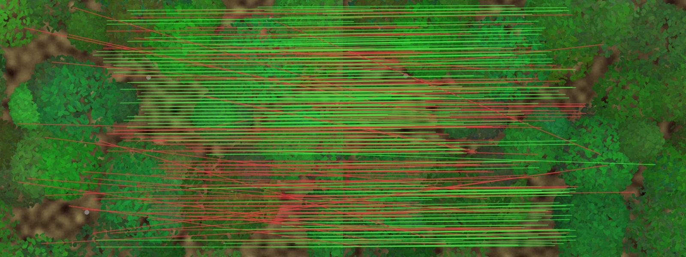
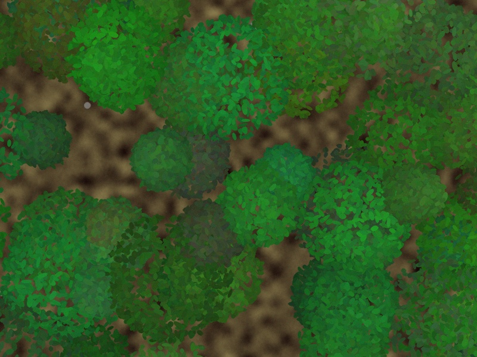
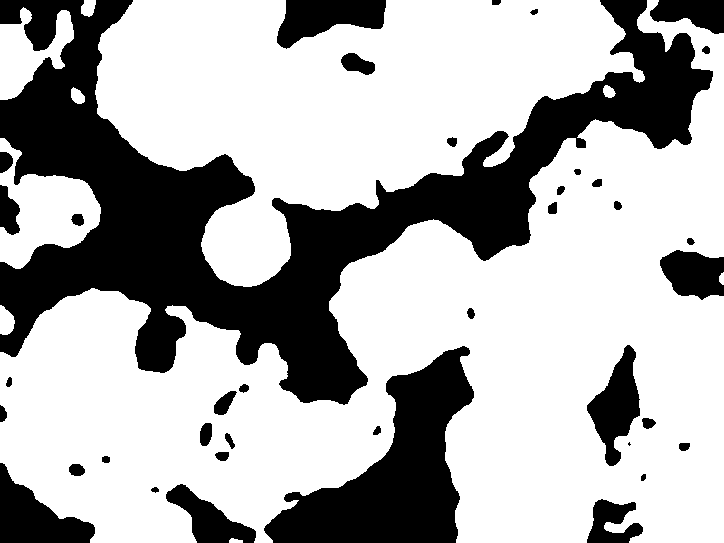
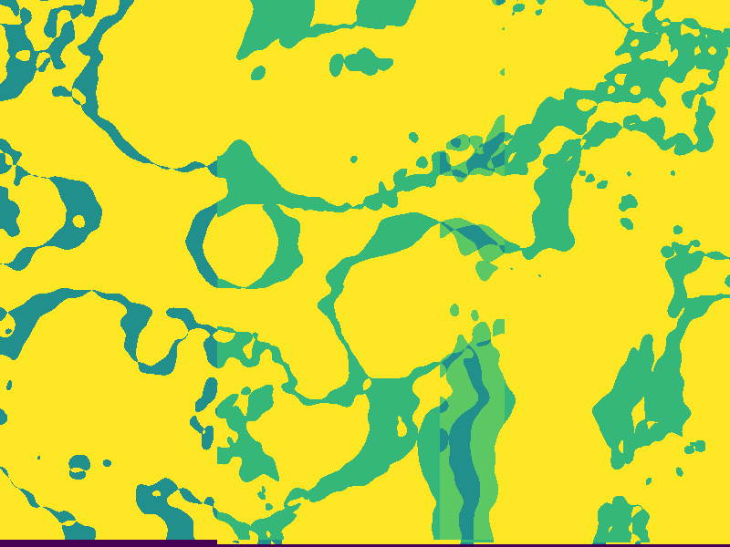

# Foliage-robust feature matching (prototype)

Tests ways to match overlapping drone photos of vegetation, where SfM tools like
DJI Terra struggle. Works on a synthetic canopy (exact ground truth) or real DJI photos.



| Synthetic canopy | Binary pattern | Agreement map |
|---|---|---|
|  |  |  |

## Setup
```bash
python3 -m venv .venv
.venv/bin/pip install -r requirements.txt        # core (CPU)
.venv/bin/pip install -r requirements-gpu.txt    # optional: LoFTR / LightGlue
```
With an NVIDIA GPU, install the CUDA build of PyTorch; the code then uses CUDA with
fp16 automatically (`--device cpu` forces CPU).

## Run
```bash
.venv/bin/python run_experiment.py                                   # synthetic, CPU methods
.venv/bin/python run_experiment.py --methods sift,loftr,consensus_loftr,lightglue
.venv/bin/python run_experiment.py --wind 4 --crowns 350             # harder synthetic day
.venv/bin/python run_experiment.py --images /path/to/dji_photos --canopy-height 20 \
    --methods sift,blobs,consensus_sift,loftr --prior-gate 150
```
Real photos are paired in filename order (adjacent shots). Outputs go to `--out`
(default `results/`): `results.csv`, `matches_<method>.jpg` (green = RANSAC inlier,
red = rejected), `binary_*.png`, `agreement_*.png`.

## Methods
| name | what it does |
|---|---|
| `sift` | baseline SIFT + ratio test |
| `blobs` | vegetation index -> blur pyramid -> binarize -> crown/gap blob shapes, matched near the GPS-predicted spot |
| `mser` | MSER (regions stable across all thresholds) + SIFT descriptors |
| `consensus_*` | same method, restricted to pixels where neighbouring photos agree |
| `loftr`, `lightglue` | learned matchers via Kornia (CUDA if available) |

## Layout
- `foliage/vegetation.py` – Excess Green / NDVI, anti-aliased blur pyramid
- `foliage/blobs.py` – binarization, blob descriptors, guided matching, MSER
- `foliage/consensus.py` – warp neighbours, majority vote, agreement map
- `foliage/matchers.py` – SIFT, learned matchers, mask / pose-prior filters
- `foliage/verify.py` – MAGSAC fundamental-matrix check, coverage, ground-truth scoring
- `foliage/dji_meta.py` – DJI XMP/EXIF pose -> ground-plane homography (nadir shots)
- `foliage/synthetic.py` – layered canopy renderer with parallax, wind, GPS noise
- `foliage/device.py` – CUDA / OpenCL / thread detection

## Early findings (synthetic, 4 pairs, dense canopy, 1.5 px wind)
| method | correct inliers/pair | coverage | precision |
|---|---|---|---|
| SIFT | 16.5 | 14% | 84% |
| binary blobs | 1.8 | 21% | 11% |
| LightGlue | 228 | 57% | 43% |
| LoFTR | 789 | 70% | 66% |

- Binary blobs repeat poorly (~5% within 5 px) under layered canopy parallax.
- Remaining LoFTR errors lie along the flight direction (epipolar line), invisible to
  two-view RANSAC. Next step: multi-view track consistency (keep matches that agree in 3+ photos).
- Synthetic results only; re-measure on real flights. Raw numbers: `docs/figures/results.csv`.
- `foliage/dji_meta.py` has not yet been tested on real DJI images.
